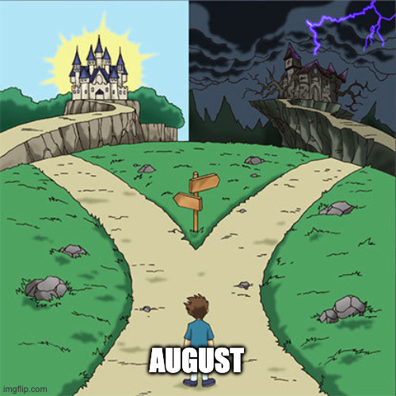

If I go back and think about the choices that I made in life, until today, I can think of three that made the most impact.

First. Joining NIT Calicut for my undergraduate education. 
Second. Shifting to Banglore and starting a 9to5. 
Third. Joining NYU for my masters education and shifting to New York.

The first two decisions were really easy. After finishing highschool, no point in staying back, everyone moves to college. 
After undergraduate, no point in staying back, (mostly) everyone joins a 9to5. 

But, going for masters *abroad* felt different. The decision was not easy. I am leaving behind my wonderful family, dear friends, and my *sweet*, *sweet* financial freedom back in India.

Shifting to NYC is my decision and I am grateful that I am able to run such an experiment with my life. I am grateful for the opportunity. But it comes with its own set of sacrifices.

A friend recently introduced me to a word. *Saudade*. It’s a Portuguese word that describes an emotional state of melancholic or profoundly nostalgic longing for a beloved yet absent someone or something. (source: [wikipedia](https://en.wikipedia.org/wiki/Saudade).)

August was bittersweet month.
