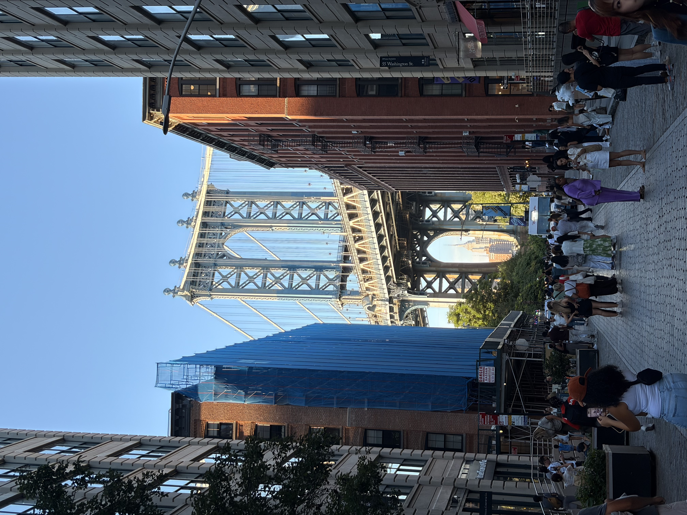
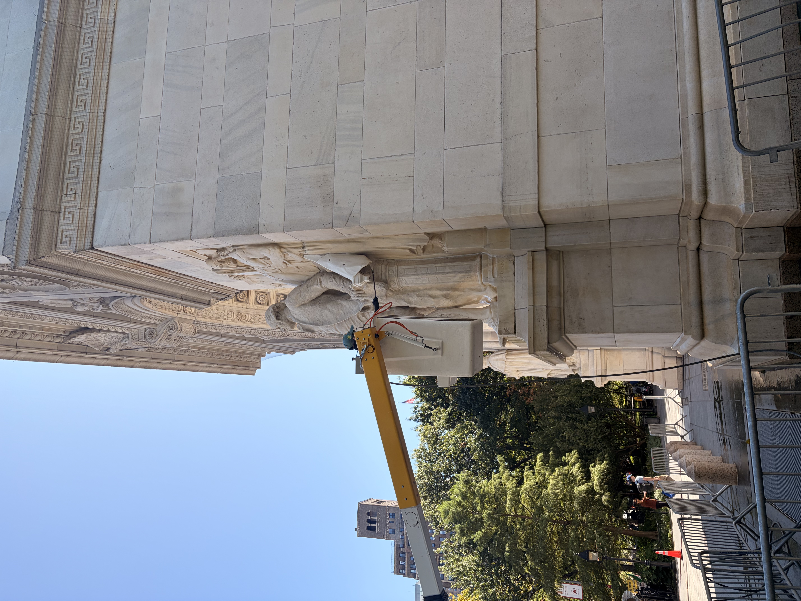
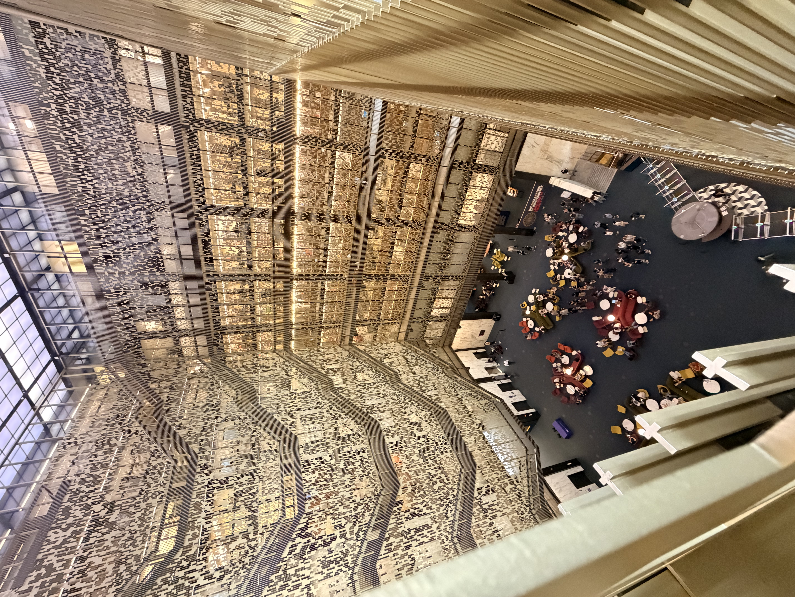
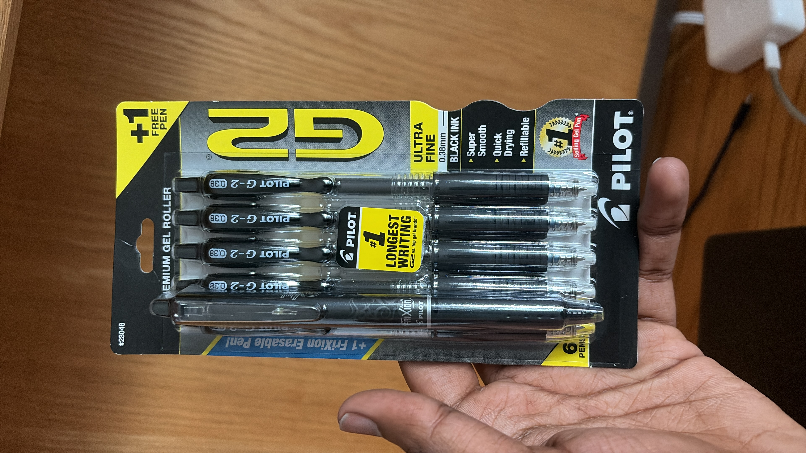

 Dumbo 

 Chobani 

This site has lately turned into a glorified dear diary page.

Anyways. 

September, for me, was the month of hyper optimizing basic necessities: food, shelter and clothing. These were functions that were abstracted out of my life for 24 years. Now I have to deal with them. *alone.*

The overarching theme for this month was focusing on building small habits over weekly once heavy lifting. 

Shelter, was easy, I stay in an NYU managed apartment. So safety is not a big concern. 

Exercise: 
I have been hitting the gym >3 times a week. If I dont feel motivated, I go for a walk around [washington square park](https://en.wikipedia.org/wiki/Washington_Square_Park#/media/File:Washington_Square_Arch-Isabella.jpg). Exercise coupled with my calorie deficit diet; I believe I am the healthiest I have ever been in my adult life. 

 
Food. This is the one where you get the most number of external advise. Staying in calorie deficit is a priority for me. 

My guiding strategy was to lower expectations, meet protein goals and count every calorie taken in. 

Breakfast, Lunch, and dinner takes 30 min to cook, eat and clean. (I have been using a stopwatch, and I am consistently hitting this number)

House cleaning: Unlike my undergraduate college, I don’t have a cleaning helper for my room. 

I use a vacuum cleaner to clean around my bead once in a while, not very frequent, when it gets visibly dirty. 

For toilet, I clean it after every use. Cleaning after every use keeps the cleaning job quick and the toilet remains clean for every use. 

***

My reynolds’s (india) pen stopped working midway during an exam. I suspect it’s the temperature difference between Trivandrum and New York acting up. I bought some local pens. I’ll give back all my Indian pens to achan when I go back in December. 

NYU printers use US Letter paper size and not A4. This is a bit annoying. 

Washing and folding clothes every two weeks takes around 5hrs 

Mil, for tea, takes around 3min 40sec to boil. 

Poaching chicken breast is a very efficient way of meeting your protein goals. But the taste is not be the best.
